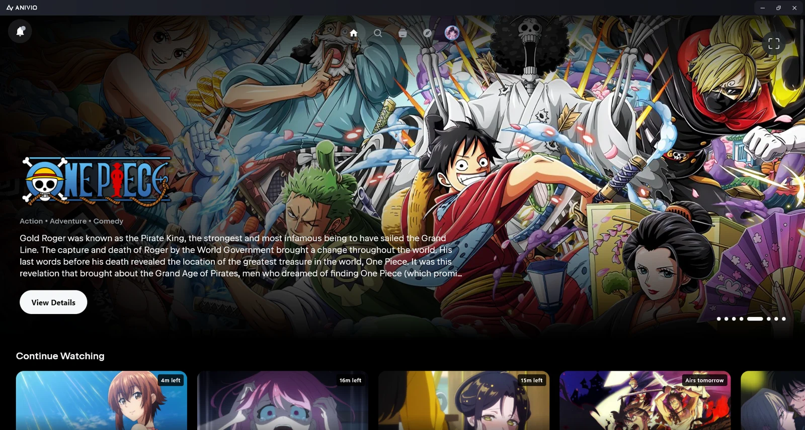

<div align="center">

  

  <p>
    A free, open-source <strong>anime player for Android and Windows</strong>, with a manga reader on Android.
  </p>

  [Website](https://anivio.eu.cc/) · [Downloads](https://anivio.eu.cc/#download) · [Releases](https://github.com/mdtahseen7/Anivio/releases)

</div>

## Get Anivio

| Platform | Download |
| --- | --- |
| Android | Get the APK for your device from [GitHub Releases](https://github.com/mdtahseen7/Anivio/releases). |
| Windows x64 | Get the EXE installer from [Anivio Downloads](https://anivio.eu.cc/#download). |
| Web | Sign in to your [Anivio dashboard](https://anivio.eu.cc/account). |



## Features

- Browse trending and seasonal titles from AniList, check airing dates, and explore episodes, trailers, reviews, and related titles.
- Connect Stremio-style addons and provider plugins, choose sub or dub streams, and download episodes for offline viewing.
- Customize subtitles, skip intros and outros, and use optional Anime4K enhancement on supported playback engines.
- Watch together with synchronized playback and chat in Watch Party.
- Keep separate libraries and watch progress for each profile. Customize avatars and anime backgrounds, and connect AniList to update your lists.
- Read manga on Android with saved chapter progress and configurable reading directions.

The web dashboard brings Continue Watching, profiles, saved titles, sources, and synced app preferences into one place. The homepage includes an interactive desktop screenshot gallery. [Explore the website](https://anivio.eu.cc/#features)

## Development branches

- [`main`](https://github.com/mdtahseen7/Anivio/tree/main) is the default branch for Android and the website.
- [`windows`](https://github.com/mdtahseen7/Anivio/tree/windows) is the Windows source branch.

Run **Anivio release** from `main` with **Build Windows x64 and attach it to the same release** enabled to package the Android APK and Windows EXE under one version. Choose **Draft** to review the packages, **Publish** to release them, or **Artifact** to save test builds in Actions. [Release workflow](https://github.com/mdtahseen7/Anivio/actions/workflows/build-apk.yml) · [Release guide](scripts/ANDROID_RELEASES.md)

## Build from source

```bash
git clone https://github.com/mdtahseen7/Anivio.git
cd Anivio
```

### Android

Requires Android Studio and the Android SDK.

```bash
./gradlew :androidApp:assembleFullDebug
```

### Windows

Windows packages are built from the `windows` branch with the native libmpv player, WebView2 SDK, and Inno Setup installer. [Windows packaging workflow](.github/workflows/windows-package.yml)

### Website

```bash
cd website
npm ci
npm run dev
```

See the [website setup guide](website/README.md) for the Supabase configuration, tests, and production build.

### iOS

Requires macOS and Xcode.

```bash
env NUVIO_IOS_DISTRIBUTION=full xcodebuild \
  -project iosApp/iosApp.xcodeproj \
  -scheme iosApp \
  -configuration Debug \
  -sdk iphonesimulator \
  -derivedDataPath build/ios-derived-full-simulator \
  CODE_SIGNING_ALLOWED=NO \
  build
```

The shared app is built with Kotlin Multiplatform and Compose Multiplatform.

## Credits

Anivio is maintained by [Stella](https://github.com/mdtahseen7) and built on [Nuvio](https://nuvio.tv). Video enhancement includes work from the [Anime4K project](https://github.com/bloc97/Anime4K).

## License

[GNU General Public License v3.0](./LICENSE)
